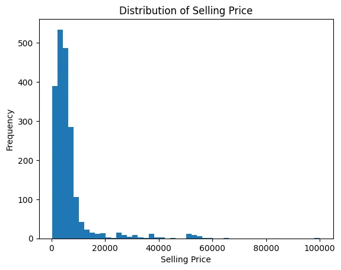
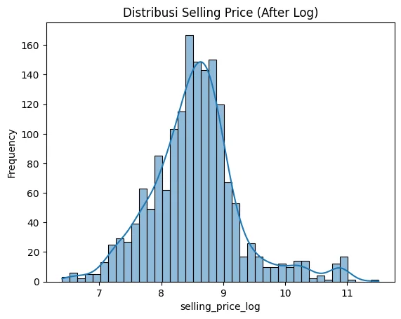
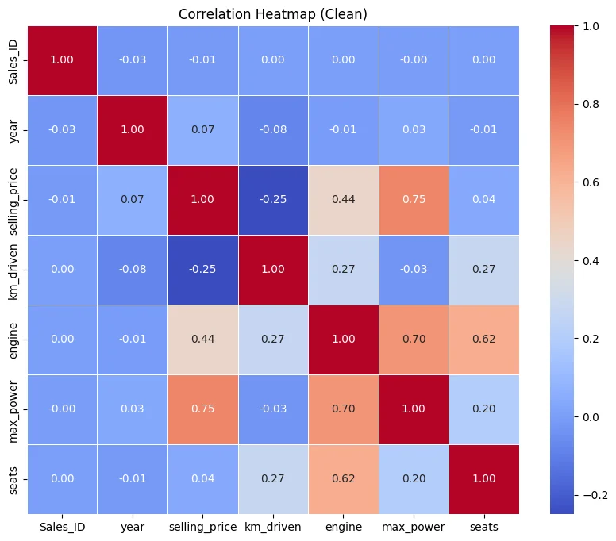
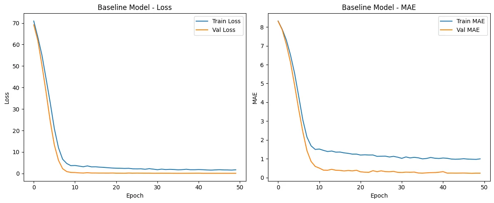
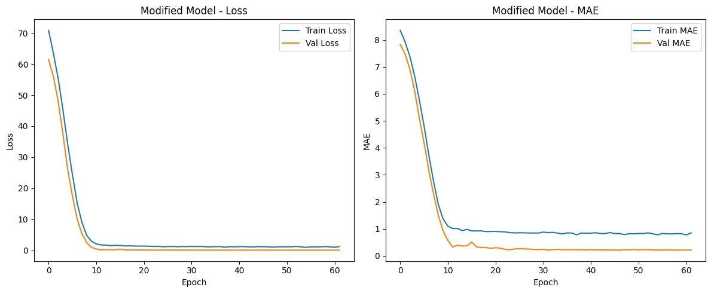
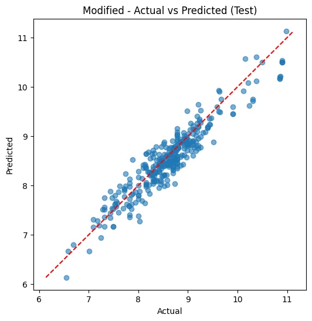
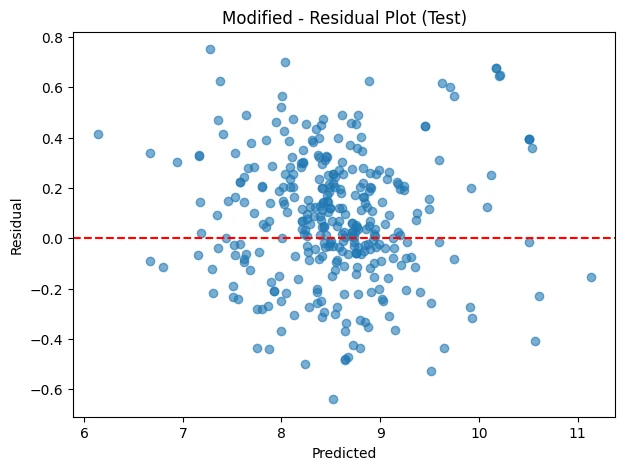

# Used-Car Price Prediction — ANN Regression

**Individual academic Deep Learning project | Structured/tabular regression | TensorFlow / Keras | Grade A**

This repository documents an Artificial Neural Network (ANN) regression experiment predicting used-car selling prices from mixed-format technical, usage, and location attributes. It includes the **original submitted notebook and PDF**, authentic output charts, and an explicit discussion of evaluation units. Results come from **saved notebook outputs**, not a new training run.

## At a glance

| Original dataset | Cleaned modeling data | Split | Best recorded test result |
|---|---|---|---|
| **2,000** vehicle records × **18** original fields | **1,648** cases; **45** model-ready features | Train **1,153**, validation **165**, test **330** | Modified ANN **R² = 0.877696**, **RMSE = 0.262455** on **log1p(price)** |

> **Metric units matter:** The ANN predicts `log1p(selling_price)`. Its logged MAE, MSE and RMSE are evaluated **on log-transformed targets**, not in USD; the relative improvement shown here is *not* a percentage decline in dollar pricing error. The notebook does not provide inverse-transformed dollar MAE or RMSE.

## Data and problem framing

The original academic file is read as `1B.parquet`; each row describes a used vehicle listing/sale. The recorded source contains `selling_price` (USD), `year`, `km_driven`, `name`, region/state/city, `fuel`, `seller_type`, `transmission`, `owner`, `mileage`, `engine`, `max_power`, `torque`, `seats` and a record ID. The raw Parquet file was **not included** in the uploaded materials.

The dataset had **two missing target prices** and **no exact duplicate source rows**. Notable data-quality issues included the impossible production year **3011** and an invalid **-100** engine-power entry. `mileage` was text-typed despite representing a numeric value, while `torque` mixed Nm, kgm and RPM notation. Mean price was about **USD 6,500.86**, above the median **USD 4,500**, consistent with a long upper price tail.





## Preprocessing and feature engineering

1. Inspect every field, duplicates, missing target prices, inconsistent physical values and potential outliers before filtering.
2. Parse mixed-format `torque` into `torque_nm` and `torque_rpm`; convert string-stored mileage into a numeric measurement.
3. Derive vehicle `brand`, car age, distance travelled per year (`km_per_year`) and an engine-to-power ratio.
4. Apply `log1p` to the right-skewed target `selling_price`; the notebook's final error metrics therefore have transformed rather than dollar units.
5. Perform a seeded **70/10/20** random split into train (1,153), validation (165) and test (330). The final cleaned cohort contained **1,648** rows.
6. Build a training-only `ColumnTransformer` with standardization for numeric predictors and one-hot encoding for nominal categories; avoid using validation/test labels to fit the categorical location-derived signal (`state_high`). The final ANN input width was **45** after encoding.
7. Track losses with `EarlyStopping`, `ReduceLROnPlateau`, `ModelCheckpoint`, and CSV logging. Transform test features only with the preprocessing objects fitted on training rows.



## Models and experiments

The baseline used two ReLU hidden layers of **90 units each** with BatchNormalization, Dropout **0.30**, L2 regularization, and a linear scalar output. A modified design used **90 then 45 hidden units** and lighter Dropout **0.10**, with the same basic regression objective.

| Model | Test MAE (log) | Test MSE (log²) | Test RMSE (log) | Test R² |
|---|---:|---:|---:|---:|
| Baseline ANN | 0.237316 | 0.089123 | 0.298535 | 0.841760 |
| **Modified ANN** | **0.207360** | **0.068883** | **0.262455** | **0.877696** |

The modified architecture reduced test RMSE by **about 12.1% relative** to the baseline in the log-price target space. This pattern is consistent with a more suitable capacity/regularization trade-off for a relatively small structured dataset, but two experiments cannot isolate which change caused the improvement.









## Reproduction and provenance

- Original executed Jupyter notebook: [`notebooks/used_car_price_ann.ipynb`](notebooks/used_car_price_ann.ipynb).
- Submitted PDF: [`reports/original_used_car_price_regression_report.pdf`](reports/original_used_car_price_regression_report.pdf).
- Original tabular source `1B.parquet`: **not provided**. See [`data/README.md`](data/README.md).
- Images in [`figures/`](figures/) are **authentic output images extracted from saved notebook cells**, not simulated experiments.
- The original notebook stores checkpoints under local `checkpoints/` paths; checkpoints are not supplied and are ignored in this repository.
- `requirements.txt` is an illustrative dependency specification. No clean-install reproducibility or independent training run has been verified.
- Notebook contains original academic identification and a coursework video link. Review those before public upload.

```bash
python -m venv .venv
# Activate the virtual environment for your OS
python -m pip install -r requirements.txt
jupyter lab notebooks/used_car_price_ann.ipynb
```

The notebook expects `1B.parquet` in its current working directory; open Jupyter from the directory containing this file or adapt the path locally. The dataset has **not** been redistributed, so full training needs the original source data.

## Limitations and next steps

The model has not been deployed or validated on fresh out-of-time transactions. The reported accuracy is an **R² score for transformed prices**, not a percentage prediction accuracy. For business-facing use, future evaluation should invert predictions using `expm1` and calculate USD MAE/RMSE, compare against traditional regressors, and investigate state/brand generalization and target-encoding leakage with out-of-fold training encodings.
